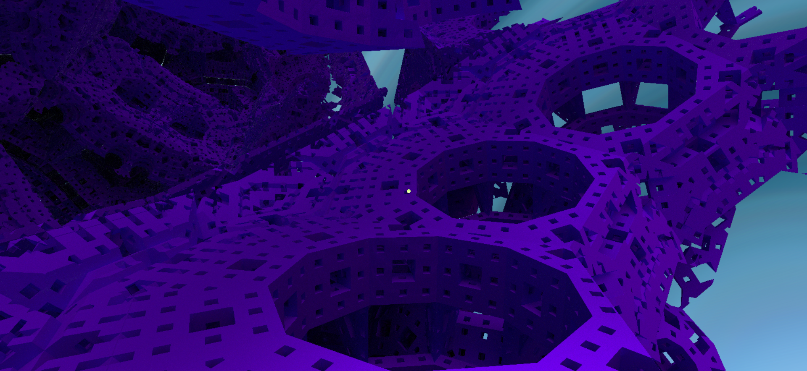
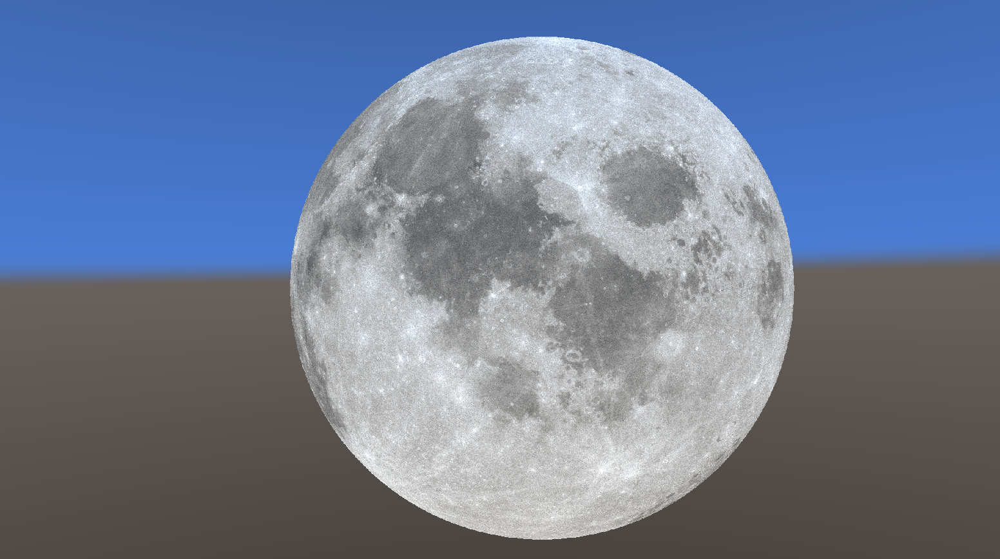

  

    <table align="center">
      <th>
        
      </th>
      <th>
        
      </th>
    </table>
  

  

  <table align="center">
    <th>
       
    </th>
    <th>
      
      <!---->
    </th>
    <th>
      
    </th>
  </table>

