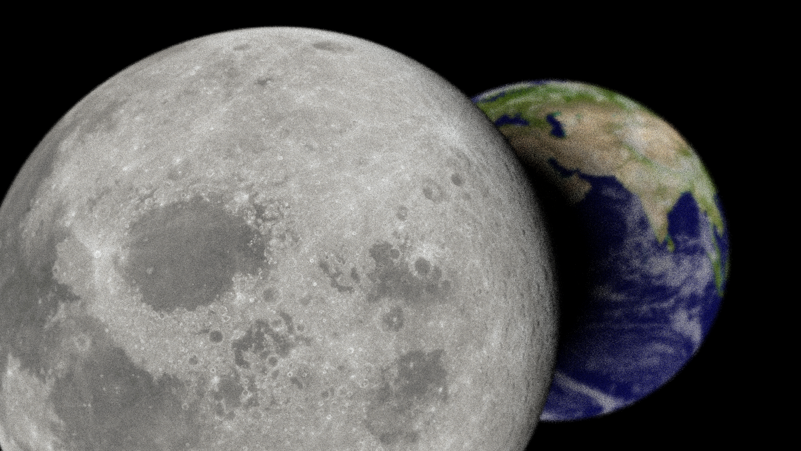
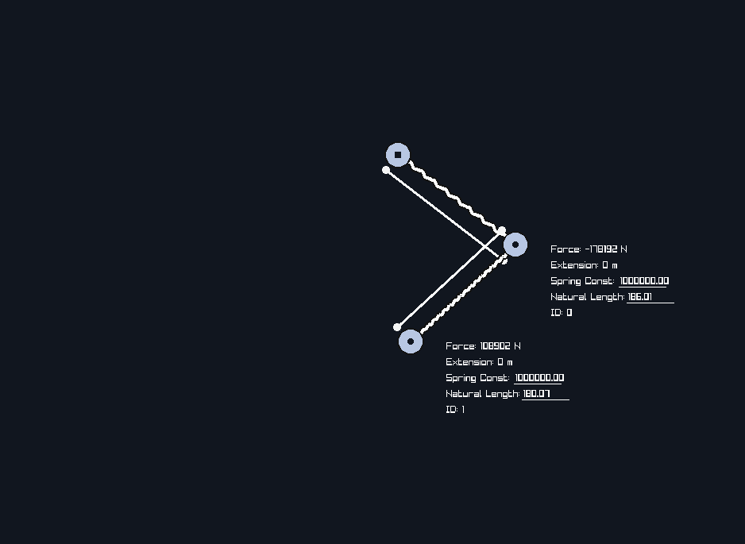
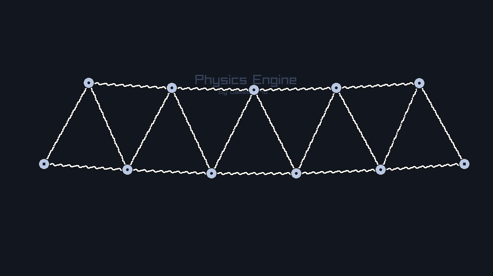
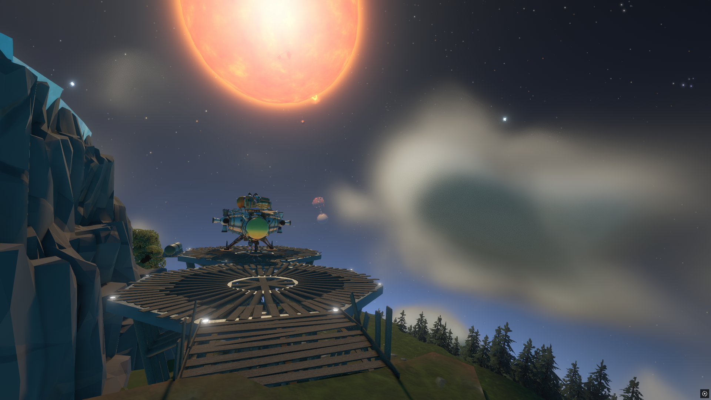

  <!--

    <table align="center">
      <th>
        
      </th>
      <th>
        
      </th>
    </table>
  

  
-->

  <table align="center">
    <tr>
      <th>
         
      </th>
      <th>
        
      </th>
      <th>
        
      </th>
    </tr>
    <tr>
      <th>
         
      </th>
      <th>
        
      </th>
      <th>
        
      </th>
    </tr>
    <tr>
      <th>
         
      </th>
      <th>
        
      </th>
      <th>
        
      </th>
    </tr>
  </table>

